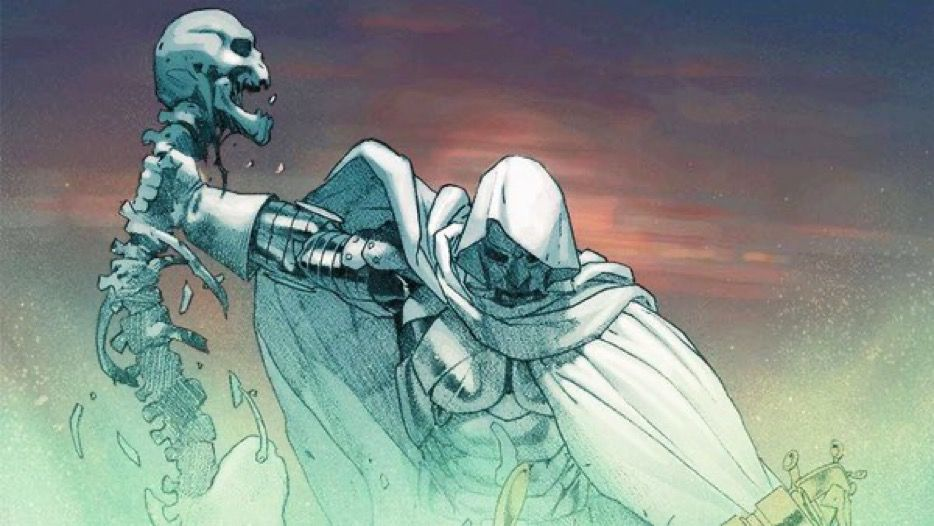
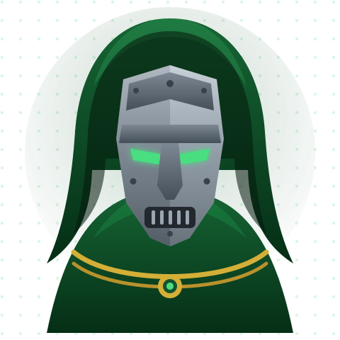

## Hi 👋, I'm Ronak

**ML / AI Product Builder**

`Build. Ship. Repeat.`

Third-year Electrical Engineering undergrad at NIT Silchar, building ML products end-to-end — models, backends, and interfaces people actually use.

---

## 🚀 About Me

I'm **Ronak Agarwal** — a third-year **Electrical Engineering** undergraduate at **NIT Silchar** (Class of 2028), based in Assam, India. I build at the intersection of **machine learning, products, and entrepreneurship**.

- **Exec Head** — E-Cell NIT Silchar
- **Marketing & PR Head** — ML Club NIT Silchar
- I enjoy building scalable, production-minded ML/AI systems with clean architecture — and interfaces that feel effortless.

**What I've built:**
- **ROScan** — multimodal agent that verifies phone insurance claims from photos
- **ROSense** — Hinglish support-message triage with an ML classifier + risk engine
- **ROamly** — AI trip planner with maps, budgets, and an itinerary-building chat
- **PromptHeist** — an AI red-teaming playground

My goal is simple: write clean code, build reliable software, and grow into an engineer whose systems last.

Off the keyboard: movies, gaming, and building in public.

 

---

## 🤝 Connect

&nbsp;&nbsp;
&nbsp;&nbsp;
&nbsp;&nbsp;

**Work:** ronak.agarwal.work@gmail.com &nbsp;·&nbsp; **College:** ronak_ug_24@ee.nits.ac.in

For internships, collaborations, hackathons, or E-Cell / ML Club NIT Silchar — email or LinkedIn gets the fastest response.

## Languages I speak

**English** · **Hindi** · **Marwari** · **Assamese**

---

## 💻 Tech Stack

**Languages**

**Frameworks & Libraries**

**Data & Tools**

---

## 📌 Featured Projects

&nbsp;

&nbsp;

Live demos: [ROScan](https://roscan.streamlit.app) · [ROSense](https://rosense.streamlit.app) · [ROamly](https://roamly.up.railway.app)

---

## 📊 GitHub Stats

---

